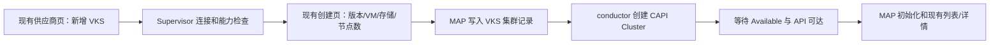

# MAP 统一 Supervisor 集群类型为 VKS：设计方案

日期：2026-10-26。状态：首期 VKS 创建链路在 `vks` 分支实施中，尚未部署；显式同步和存量迁移属于后续阶段。依据：`/data/claude/k8mgmt` 的 Supervisor/VKS 实现和 MAP 当前代码。用户要求：删除 TKGS 与 TKG2S 产品入口，以 VKS 替代；MAP 前端尽量沿用现有页面。

实施进度：已接入 VKS 供应商、资源查询、单工作池创建、conductor 状态跟踪、远端 UID 保护删除，以及现有门户表单与详情；TKGS/TKG2S 新建已拒绝，但保留存量读取和处理。OSImage 现按所选 KubernetesRelease 发现并自动选择版本；旧 Supervisor 没有 OSImage API 时仍由创建预检的准入校验判断。待补：供应商 Dry-run 直接查询 `vmClasses` 等资源字段、显式同步纳管、旧记录迁移和端到端 Supervisor 验证。

## 目标与边界

- **最终状态**：MAP 的 Supervisor 供应商、创建集群、列表、详情和生命周期统一使用 `VKS` class。新请求不再接受 TKGS/TKG2S；前端不显示这两个类型。TKGM/TKG2M 属管理集群路径，不在本次删除范围。
- **前端少改**：沿用现有供应商页、TKGS 表单布局、创建向导、集群列表和详情路由；将页面上的 Supervisor 类型文案及 GraphQL 映射改成 VKS。首期创建一个工作节点池。
- **数据安全**：删除“旧类型/实现”不等于删除已有集群记录或 Supervisor 上的集群。先盘点并迁移，再移除旧后端处理分支。不能把旧 TKGS 的 `TanzuKubernetesCluster` 数据直接改写成 VKS 的 CAPI `Cluster`。
- **范围**：首期接入 Supervisor、创建 VKS、显示 MAP 创建的 VKS、跟踪状态和安全删除。第二阶段提供与 k8mgmt `sync=true` 对应的显式发现/同步：现有列表增加一个同步动作，发现的远端 VKS 先以“待纳管”只读状态展示，确认后才初始化 MAP 管理凭据。多工作池编辑、伸缩和升级在后续阶段。

## 现状与替代关系

| 现有类型 | 当前实现 | VKS 替代方式 |
| --- | --- | --- |
| TKGS | 使用 `run.tanzu.vmware.com` 的 `TanzuKubernetesCluster`；门户有完整供应商和创建表单 | 停止新建；复用其页面结构，但提交 VKS API；旧 TKGS 集群须单独重建/迁移或解除纳管 |
| TKG2S | 已使用 Cluster API `Cluster`，但版本发现依赖旧 TanzuKubernetesRelease，规格限固定工作池；门户未完整接入 | 停止新建；逐个检查远端 CR、ClusterClass、release 和 UID，满足兼容条件时显式迁为 VKS 纳管记录 |
| VKS | 尚无独立类型 | 使用 Supervisor 的 Cluster API `Cluster`；按目标环境发现 KubernetesRelease、ClusterClass、VMClass、StorageClass 和 OSImage |

MAP 证据：[集群类型/规格](../../../mapd/pkg/model/cluster.go)、[供应商模型](../../../mapd/pkg/model/cluster_provider.go)、[创建 resolver](../../../mapd/pkg/graphql/resolver/cluster.resolvers.go)、[TKG2S 旧版本选择](../../../mapd/pkg/util/tanzu/v2/vsphere.go)、[conductor 分流](../../../mapd/pkg/conductor/conductor_cluster.go)、[GraphQL 集群类型](../../../mapd/docs/graphql/cluster.graphql)、[供应商类型](../../../mapd/docs/graphql/cluster_provider.graphql)。k8mgmt 证据：`/data/claude/k8mgmt/internal/api/v1/vks/vks.go`、`pkg/supervisor/supervisor_auth.go`、`vks_cluster_service.go`、`vks_template_service.go`。

## 目标流程

1. **供应商**：只保留一个 Supervisor 类型“VKS”。沿用 endpoint、账号密码、CA、默认 namespace、镜像仓库和连接测试控件。后端校验实际 API、授权和命名空间；密码加密存储，短期 token 不落库。
2. **资源发现**：后端按所选 namespace 返回版本、VMClass 和 StorageClass，供现有创建控件使用；同时读取 ClusterClass、classNamespace、OSImage、变量 schema。新版优先 `kubernetes.vmware.com/v1alpha1` KubernetesRelease；旧 API 是否允许仅作为环境兼容逻辑，不再显示为“TKG2S”。
3. **创建**：保留当前表单的控制节点数、工作节点数、规格、存储和 CIDR。后端把这些输入映射为 CAPI topology 的控制节点和**一个具名工作节点池**。ClusterClass、OSImage 等只有在兼容候选唯一时自动选择；多个候选时在原表单加一个条件下拉。与目标 ClusterClass 不兼容的字段必须明确报错，不静默忽略。
4. **状态与展示**：沿用 MAP 的 `cluster` 表与 conductor 持久调谐；列表展示 `VKS`、状态和版本，详情在现有信息区补 namespace、ClusterClass、节点就绪数和错误原因。未实现的规格调整、控制节点调整等操作隐藏，待 VKS API 完整支持后开放。
5. **同步已有 VKS**：沿用集群列表，增加小型“同步 Supervisor”动作；后端按供应商授权的 namespace 扫描 CAPI Cluster，以 provider+namespace+remote UID 去重。发现项先标记为“待纳管”，不运行 MAP 的创建或扩展安装流程；用户确认纳管后才获取工作集群凭据并初始化。普通列表查询只读本地数据，不隐式执行全量远端扫描。
6. **删除**：沿用现有删除弹窗，但删除前核对 provider、namespace、远端 UID 与 MAP 归属。远端失败时保留本地记录供重试；同名但 UID 不同的资源绝不删除。待纳管项只允许移除发现记录，不删除远端资源。

## 后端改造

| 模块 | 最终改动 |
| --- | --- |
| `mapd/pkg/model` 与 GraphQL schema | `ClusterClass`、供应商/集群 spec 增加 `VKS`；新增 `Create/UpdateVKSClusterProvider` 和 `CreateCluster.spec.vks`。迁移完成后删除 TKGS/TKG2S enum、union、输入、mutation 与生成代码。 |
| Supervisor client | 将 k8mgmt 的认证、能力发现、资源选择和模板思路适配 MAP 客户端。TLS 默认验证 CA；token 过期刷新。VKS 不直接调用现有 TKG2S 的旧 TKR 选择。 |
| VKS handler | 在现有 conductor 中加入 `VKS` 分流，先落库后远端创建；创建冲突返回错误，不更新同名外部集群。保存远端 UID/MAP 标签，重启后可幂等续接。 |
| 关联模块 | 更新 cluster resolver/helpers、provider resolver/helpers、cluster-extension dispatch、备份辅助逻辑与权限检查中 TKGS/TKG2S 分支；移除旧 handler 前先处理存量记录。 |
| 列表 | 继续使用 MAP `Clusters` 查询与组织权限过滤。首期只出现 MAP 已建记录；第二阶段增加显式 Supervisor 同步 mutation、待纳管记录及确认纳管 mutation。待纳管记录对有供应商管理权限的用户可见，不能进入 conductor 创建/扩展流程。 |

资源创建遵循目标 Supervisor 当前可用的 CAPI/ClusterClass schema，不固定为 k8mgmt 示例版本。通过 Kubernetes 对象或 `unstructured` 构建 manifest，执行准入预检。集群可用后获取工作集群访问凭据并进入 MAP 原有初始化阶段；不能假定所有 Supervisor 都以相同 Secret 格式发布 kubeconfig。

## 前端最小改动

| 文件区域 | 必要改动 | 继续复用 |
| --- | --- | --- |
| `system/provider/provider.component.*`、`providerdetail/*` | 下拉删除 TKGS，增加 VKS；现有 Supervisor 表单调用 VKS mutation；详情改 VKS 标题/查询 | 表单布局、步骤、仓库/LB 控件 |
| `services/provider.service.ts`、`classes/cluster_provider.ts` | VKS GraphQL fragment、mutation 与资源字段映射；删除旧 TKGS/TKG2S 类型 | 列表服务与通用模型 |
| `cluster/management/management.component.*` | 原 TKGS 表单条件改为 VKS；提交 `spec.vks`；处理 VKS release 名称，不直接用当前 `semver.gt` 排序完整 release 名；第二阶段在列表增加“同步 Supervisor”动作 | 列表、向导布局、表单控件、成功刷新 |
| `services/clusters.service.ts`、`cluster/clusterdetail/*` | VKS spec/status fragment；替换旧类型判断；按能力隐藏不适用的旧操作 | 统一详情路由与现有布局 |

不新增独立 VKS 页面、多工作池编辑器或导入向导。已有集群中若存在旧 class，迁移期间应在原列表标为“待迁移”，只允许安全查看/处理，避免页面因删除 GraphQL 类型而报错；完成迁移后再彻底移除旧代码与文案。“待迁移”（旧 MAP 类型）与“待纳管”（Supervisor 上已有、MAP 新发现的 VKS）是不同状态。

## 存量数据迁移与删除顺序

1. **只读盘点**：统计 `cluster_provider.class IN ('TKGS','TKG2S')` 及对应 `cluster`，核对 Supervisor 远端 kind/API group、namespace、name、UID、运行状态和使用中的扩展；备份 MAP 数据库。
2. **冻结旧类型创建**：前端移除 TKGS/TKG2S 选项；后端拒绝新的旧类型 provider/cluster mutation。保留旧记录的读取与调谐直至迁移完成，不能先删 enum/handler。
3. **逐类迁移**：TKG2S 若远端是兼容的 CAPI Cluster，核验 UID 和工作负载凭据后建立 VKS 记录并切换关联；不兼容则走重建/解除纳管。TKGS 的旧 `TanzuKubernetesCluster` 不做数据库 class 原地改写，按业务窗口重建为 VKS 或保留外部集群并解除 MAP 旧类型纳管。迁移操作必须可回滚，绝不自动删除旧远端集群。
4. **最终移除**：数据库旧类型引用为零后，删除 TKGS/TKG2S GraphQL schema、resolver、conductor handler、前端分支和文案；重新生成 GraphQL 代码。此时产品只保留 VKS Supervisor 类型。

如果现场仍有未迁移的旧集群，第 4 步不能执行；这是保护现有集群的硬门槛，不代表保留旧类型作为最终产品功能。

## 验收

- 供应商页只有 VKS 这一种 Supervisor 类型；旧 TKGS/TKG2S 不能新建，最终代码和 GraphQL schema 中也不再作为可用类型。
- 现有 MAP 表单能创建一个工作节点池的 VKS；能够显示创建中、运行、失败的准确原因，mapd 重启后继续跟踪。
- Supervisor 上同名外部集群不会被覆盖或误删；远端删除失败保留 MAP 记录；旧集群迁移前记录和资源完整。
- 集群列表与详情正常展示 VKS，旧 TKGS 专属操作不误触发；TKGM/TKG2M 路径不受影响。
- 第二阶段从 Supervisor 显式同步已有 VKS 后，在现有列表只读展示；未经确认不会自动安装扩展或删除远端资源。
- 测试覆盖 manifest/版本与 ClusterClass 匹配、认证与权限、GraphQL/数据库迁移、conductor 恢复、现有页面创建流程及旧类型回归/移除门槛。

## 与 k8mgmt 的关系

k8mgmt 提供 Supervisor 登录、namespace 资源发现、CAPI manifest、状态读取、已有集群同步和工作集群注册的参考实现。MAP 对齐这条**设计链路与资源模型**，在 MAP 当前 GraphQL/conductor/页面内落地；显式同步和确认纳管对应 k8mgmt 的 `sync=true` 与注册步骤。k8mgmt 的同名自动更新、远端先创建后存库、远端删除失败仍删本地记录、进程内 goroutine 监视，以及登录请求无条件跳过 TLS 验证，均不作为 MAP 目标行为。

官方 API 参考：[VKS Kubernetes Service API](https://developer.broadcom.com/xapis/vmware-vsphere-kubernetes-service/latest/api-docs.html)、[ClusterClass 变量参考](https://developer.broadcom.com/xapis/vmware-vsphere-kubernetes-service/latest/variable-docs.html)。
