# Installing and Configuring MAP on vSphere as Virtual Appliance

- [Installing and Configuring MAP on vSphere as Virtual Appliance](#installing-and-configuring-map-on-vsphere-as-virtual-appliance)
	- [Prerequisites](#prerequisites)
	- [Planning for installation](#planning-for-installation)
		- [User management](#user-management)
		- [Security](#security)
		- [Networking](#networking)
	- [Installation](#installation)
	- [Reconfiguration](#reconfiguration)
		- [Dex](#dex)
	- [Troubleshooting](#troubleshooting)
		- [Log collection](#log-collection)

This guide walks you through the steps about installing and configuring MAP on vSphere as an virtual appliance. If you are installing MAP on a Linux host, refer to this **[Installation Guide](installation_guide.md)**.

## Prerequisites
* vSphere 6.7+ and at least an ESXi host. 
* 4 vCPUs, 4GB memory and at least 64GB free disk space (depends on the volume size you desire) in datastore.
* A network with DHCP capability, or a static IP address for the virtual appliance.

## Planning for installation

This virtual appliance includes MAP and an embedded Harbor registry.

### User management

By default, Harbor users and MAP users are managed seperately, and both configured to use local authentication. Those data is stored in different database.

Harbor can be configured to authenticate against an external LDAP or AD server. For LDAP/AD authentication, user can setup this after deployment. 

MAP uses [Dex](https://dexidp.io/) for its identity management. Dex is an open source [OpenID Connect](https://openid.net/connect/) identity provider. It can be configured manually to authenticate against external IDPs with [connectors](https://dexidp.io/docs/connectors/). By default, Dex is configured to use `local` connector only.

### Security 

Harbor and MAP uses HTTPS for secure communication by default. A server certificate is generated at every boot based on its FQDN (Fully Qualified Domain Name) or IP address by default. A Docker client or a VCH (Virtual Container Host) needs to trust the certificate of Harbor's CA (Certificate Authority) in order to interact with Harbor.

By default, Harbor is configured to be accessed by its domain name (FQDN). Therefore, its IP address must have a FQDN associated with it in the DNS server (via A record). If Harbor cannot resolve its domain name (FQDN) to its IP address, you can configure it to be accessed by IP address only. Server certificate will be regenerated after a reboot to apply any FQDN or IP address changes.

If necessary, you can also specify your owned server certificate and private key during deployment. In addition, you can specify your 3rd-party trusted CA certificates during deployment as well. Self-generated certificates will then replaced by those user-supplied settings. CA certificates will be necessary while communicating with external services that are using self-signed certificates, such as provisioned TKG workload clusters, external Harbor registries, or AVI controllers. 

### Networking

The virtual appliance can obtain IP address by DHCP. This is convenient for testing purpose. For a production system, it is recommended that static IP address and FQDN be used.

For the best practice, it is recommended that a DNS record (A record) be added to associate the virtual appliance's IP address with a FQDN. This is necessary for both static IP address and dynamic IP address acquired from DHCP. If a DNS record is missing for IP address of the virtual appliance, Harbor and MAP can only be accessed by its IP address.

## Installation
1. Download the OVA file to your local disk from the **[official release page](https://gitlab.eng.vmware.com/cn-se-solution/mapd/-/releases)**.  

2. Log in vSphere web client. Right click on the datacenter, cluster or host which MAP will be deployed on. Select "Deploy OVF Template" and open the import wizard.  

	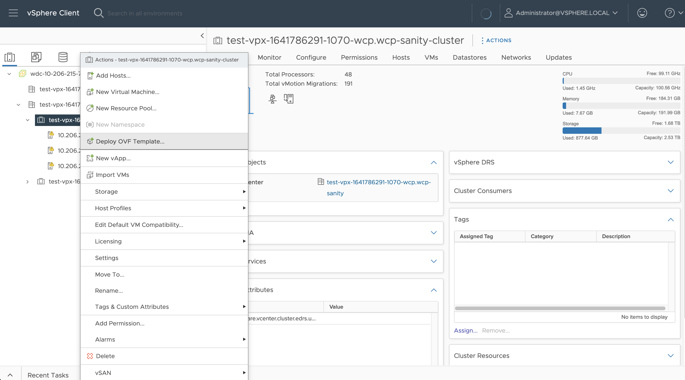

3. Select the OVA file from your local disk and click "Next".  

	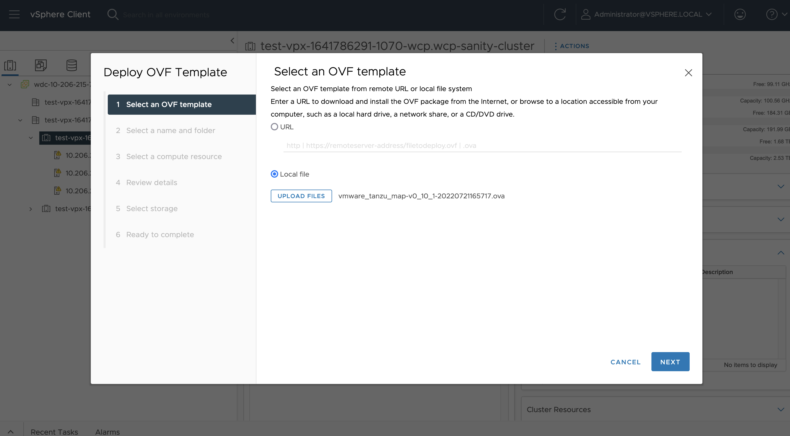

4. Specify a name and a location for the virtual appliance.  

	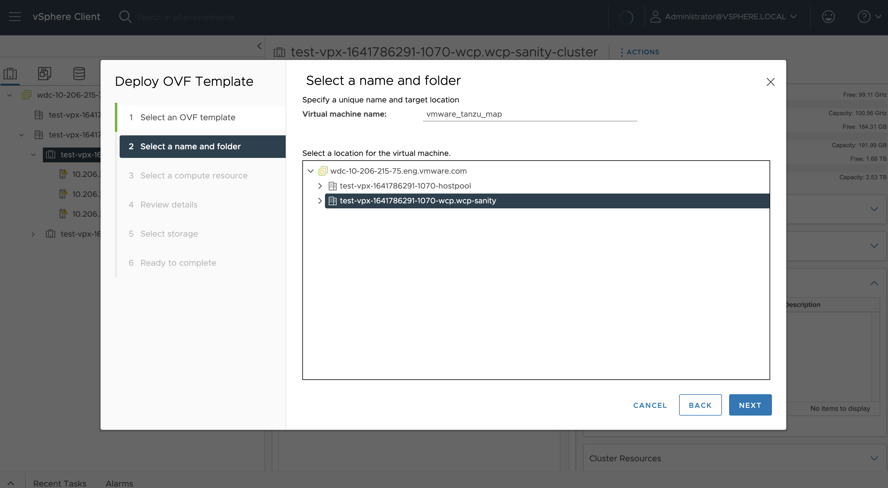

5. Select a compute source and click "Next".

	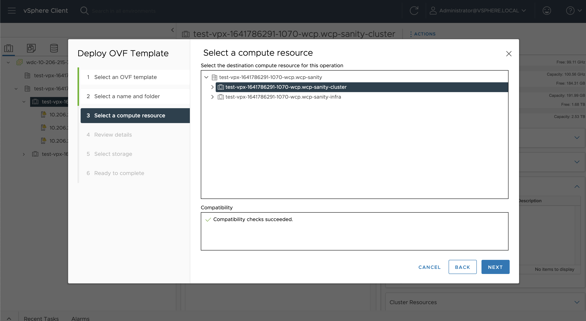

6. Review the OVF template details and click "Next".  

	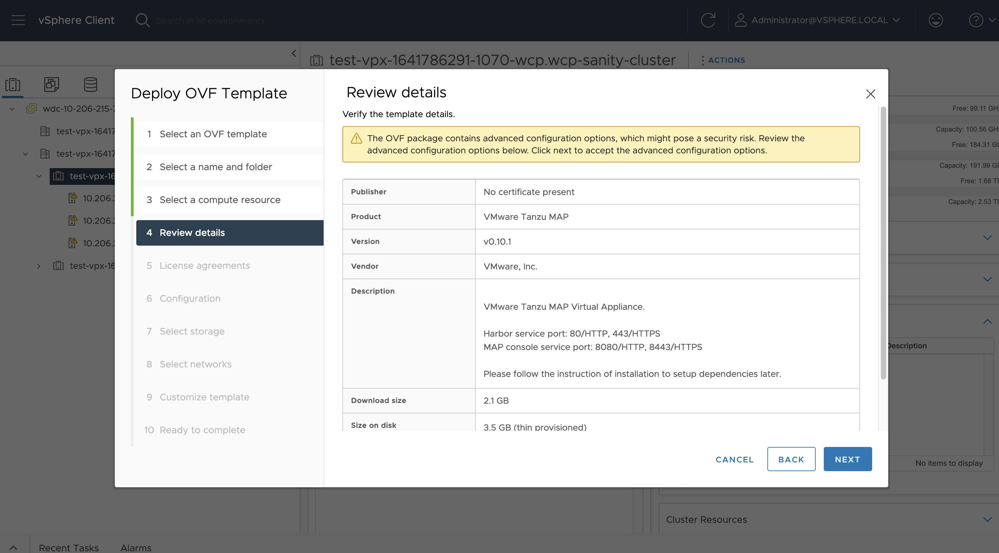

7. Accept the end user license agreements and click "Next".  

	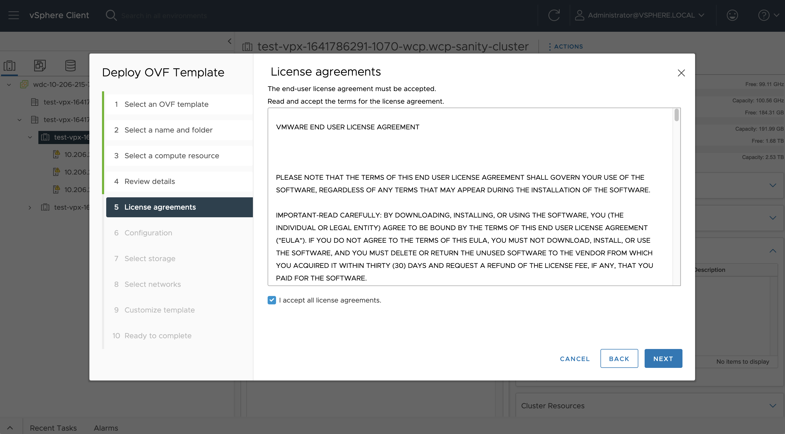

8. Choose a configuration (small/medium/large) and click "Next".

	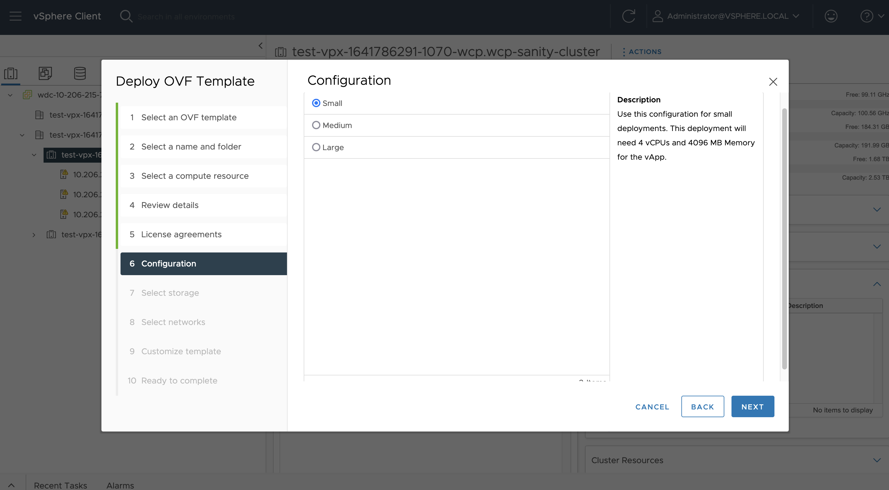

9. Select the datastore and virtual disk format, click "Next".
	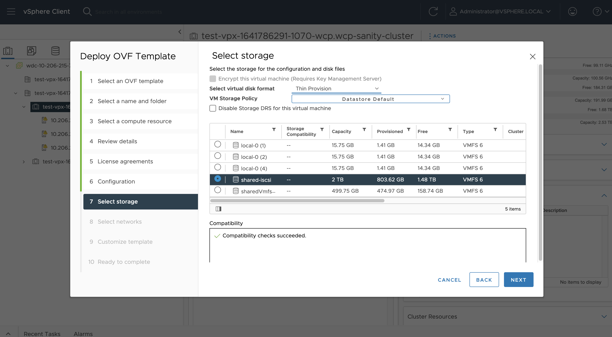

10. Configure the network(s) that the virtual appliance should be connected to.
	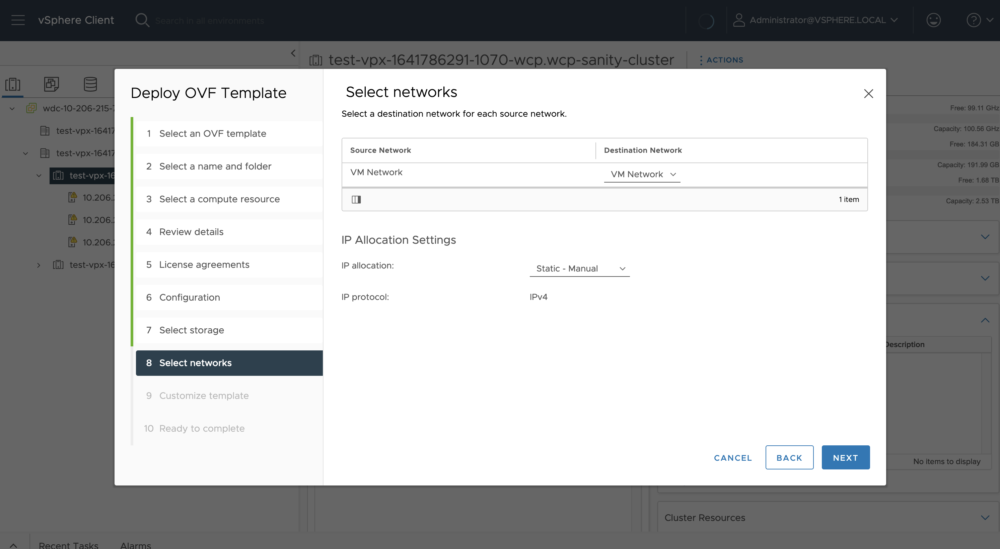

11. Customize the properties of virtual appliance. The properties are described below. Note that at the very least, you just need to set five properties: **Root Password**, **Harbor Admin Password**, **Harbor Database Password**, **MAP Admin Password**, **MAP Database Password**.

	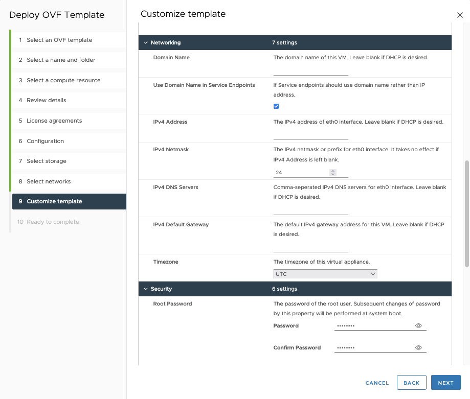

 * Hardware
	* **Docker Volume Size (GiB)**: The size (GiB) of the volume that will be mounted to /var/lib/docker.
	* **Data Volume Size (GiB)**: The size (GiB) of the volume that will be mounted to /data.

 * Security
	* **Root Password**: The password of the root user. Subsequent changes of password by this property will be performed at system boot.
	* **SSL Certificate**: Paste in the content of a certificate file (which may also contain its intermediate CA certificates). Leave blank for a generated certificate.
	* **SSL Certificate Key**: Paste in the content of a certificate key file. Leave blank for a generated key.
	* **SSL Root CA Certificate**: Paste in the content of a root ca certificate file. Leave blank for a generated root CA certificate.
	* **Enable Cross-Client Token Sharing**: If it is allowed to authorize with token that is issued to other IDP clients. The MAP server could be vulnerable when this is enabled. This is a client-side mechanism that will not affect the Dex server's behaviour.

 * Harbor
	* **Enable Harbor Registry**: Whether to install a Harbor registry in virtual appliance. Subsequent changes of this property will install/uninstall the Harbor registry, and history data will be preserved. This also works in air-gapped environment.
	* **Admin Password**: The initial password of Harbor admin. It only works for the first time when Harbor starts. It has no effect after the first launch of Harbor. Change the admin password from UI after launching Harbor.
	* **Database Password**: The initial password of the postgres user of PostgreSQL database. Subsequent changes of password should be performed in operating system.

 * MAP
	* **Admin Password**: The password of the default super admin (admin@tanzu.local). Subsequent changes of password by this property will be performed at system boot.
	* **Database Password**: The initial password of the root user of MySQL database. Subsequent changes of password should be performed in operating system.

 * Networking
	* **Domain Name**: The domain name of this VM. Leave blank if DHCP is desired.
	* **Use Domain Name in Service Endpoints**: If endpoint of services (MAP and Harbor) should use domain name rather than IP address. Disable this when IP address was not associated with the domain name.
	* **Domain Name Servers**: Comma-seperated IPv4 DNS servers for eth0 interface. Leave blank if DHCP is desired.
	* **IPv4 Address**: The IPv4 address of eth0 interface. Leave blank if DHCP is desired.
	* **IPv4 Netmask**: The IPv4 netmask or prefix for eth0 interface. It takes no effect if IPv4 Address is left blank.
	* **IPv4 DNS Servers**: Comma-seperated IPv4 DNS servers for eth0 interface. Leave blank if DHCP is desired.
	* **IPv4 Default Gateway**: The default IPv4 gateway address for this VM. Leave blank if DHCP is desired.
	* **Timezone**: The timezone of this virtual appliance.

	After you complete the properties, click "Next".  

1.  Review your settings and click "Finish" to complete the deployment.  

	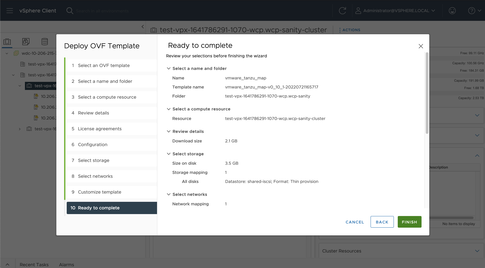

2.  Power on the virtual appliance. It may take a few minutes for the first bootup. The virtual appliance needs to initialize itself for configuration like netowrk address and password. 

3.  Verify the installation.
	* When the appliance is ready, check from vSphere Web Client for its IP address.
	* (If Harbor is enabled) Open a browser and type in the URL `https://vm_ip_address` or `https://vm_host_name` (depends on whether to *Use Domain Name in Service Endpoints*) to access Harbor.
	* (If Harbor is enabled) Log in as the admin user and verify Harbor has been successfully installed.
	* Open a new browser tab and type in the URL `https://vm_ip_address:8443` or `https://vm_host_name:8443` (depends on whether to *Use Domain Name in Service Endpoints*) to access MAP console.
	* Log in as the default admin user (admin@tanzu.local) and verify MAP has been successfully installed.

4.   Log in to the admin web console and add a image registry, e.g. `myharbor.yourdomain.com`. To use this image registry for initializing kubernetes cluster, you will need to upload MAP dependency images to this image registry.

```sh
cd /data/map/installer/map-offline-installer
./download_dependency.sh
docker login myharbor.yourdomain.com
./upload_dependency.sh -r myharbor.yourdomain.com
```

For information on how to use MAP, please refer to [User Guide of MAP](user_guide.md). For information on how to use Harbor, please refer to [Official Harbor Documentation](https://goharbor.io/docs/).

## Reconfiguration
If you want to change the properties of virtual appliance, follow the below steps:  

1. **Power off** the VM.  
2. Click on the VM and navigate to "Configure" view.  
3. Click the "vApp Options" in "Settings" menu, update the properties by clicking "Set Value".  

	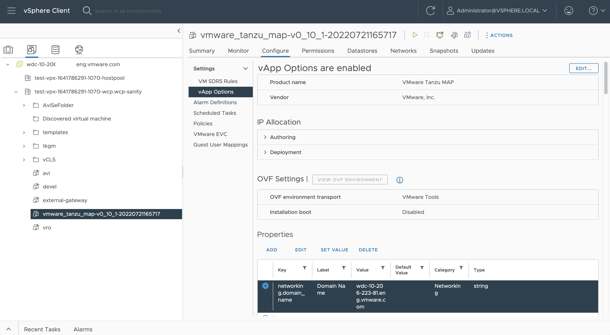

4. **Power on** the VM. The virtual appliance will reconfigure itself based on the new settings.  

**Note:**
1. The **Docker Volume Size (GiB)** and **Data Volume Size (GiB)** can only be set once before the first boot. Subsequent modification of this option does not have any effect.  
2. The initial Harbor admin password and all database passwords can not be modified using this method after VM's first launch. Modify them by the following approach:
	* **Harbor Admin Password**: Change it in Harbor admin portal.
	* **Database Password**: Change it by logging in the virtual appliance and doing it in the Linux operating system first, and then change it in "vApp Options".  

### Dex

If you want to add additional connectors to dex, please follow the below steps:

1. Login to the virtual appliance as `root`.
2. Navigate to the installer root: `cd /data/map/installer/map-offline-installer`.
3. Stop service with command: `docker-compose down -v`
4. Edit the dex configuration template file: `vi common/config/dex/config-template.yaml`.

	Keep in mind that the following block **SHALL NOT** be changed:
	```
	issuer: ${DEX_ISSUER}
	storage:
	  type: mysql
	  config:
	    host: ${MYSQL_HOST}
	    port: ${MYSQL_PORT}
	    database: ${MYSQL_DEX_DATABASE}
	    user: ${MYSQL_USER}
	    password: ${MYSQL_PASSWORD}
	    ssl:
	      mode: "false"
	web:
	  http: 0.0.0.0:5556
	telemetry:
	  http: 0.0.0.0:5558
	grpc:
	  addr: 0.0.0.0:5557
	frontend:
	  issuer: ${MAP_ISSUER}
	  dir: /opt/dex/web-${DEX_PAGE_LANG}
	  theme: map
	oauth2:
	  skipApprovalScreen: true
	enablePasswordDB: ${DEX_LOCAL_CONNECTOR_ENABLED}
	expiry:
	  deviceRequests: ${DEX_EXPIRY_DEVICE_REQUESTS}
	  signingKeys: ${DEX_EXPIRY_SIGNING_KEYS}
	  idTokens: ${DEX_EXPIRY_ID_TOKENS}
	  authRequests: ${DEX_EXPIRY_AUTH_REQUESTS}
	logger:
	  level: ${DEX_LOG_LEVEL}
	  format: ${DEX_LOG_FORMAT}
	```

	Add an additional connector like this:
	```
	issuer: ${DEX_ISSUER}
	storage:
	  type: mysql
	  config:
	    host: ${MYSQL_HOST}
	    port: ${MYSQL_PORT}
	    database: ${MYSQL_DEX_DATABASE}
	    user: ${MYSQL_USER}
	    password: ${MYSQL_PASSWORD}
	    ssl:
	      mode: "false"
	web:
	  http: 0.0.0.0:5556
	telemetry:
	  http: 0.0.0.0:5558
	grpc:
	  addr: 0.0.0.0:5557
	frontend:
	  issuer: ${MAP_ISSUER}
	  dir: /opt/dex/web-${DEX_PAGE_LANG}
	  theme: map
	oauth2:
	  skipApprovalScreen: true
	enablePasswordDB: ${DEX_LOCAL_CONNECTOR_ENABLED}
	expiry:
	  deviceRequests: ${DEX_EXPIRY_DEVICE_REQUESTS}
	  signingKeys: ${DEX_EXPIRY_SIGNING_KEYS}
	  idTokens: ${DEX_EXPIRY_ID_TOKENS}
	  authRequests: ${DEX_EXPIRY_AUTH_REQUESTS}
	logger:
	  level: ${DEX_LOG_LEVEL}
	  format: ${DEX_LOG_FORMAT}
	staticClients:
	connectors:
	# Example of LDAP connector. Full documentation can be found here: https://dexidp.io/docs/connectors.
	- type: ldap
	  id: ldap
	  name: Microsoft AD
	  config:
	    host: 10.1.2.20:636
	    # The following field is required if using port 389.
	    #insecureNoSSL: true
	    #rootCA: tmp/rootca.pem
	    insecureSkipVerify: true
	    bindDN: CN=Service Account,OU=dev,DC=example,DC=org
	    bindPW: P@ssw0rd
	    usernamePrompt: Email Address
	    userSearch:
	      baseDN: OU=dev,DC=example,DC=org
	      filter: "(objectClass=person)"
	      username: userPrincipalName
	      idAttr: DN
	      emailAttr: userPrincipalName
	      nameAttr: name
	      preferredUsernameAttr: sAMAccountName
	    groupSearch:
	      baseDN: OU=dev,DC=example,DC=org
	      filter: "(|(objectClass=posixGroup)(objectClass=group))"
	      userMatchers:
	      - userAttr: DN
	        groupAttr: member
	      nameAttr: cn
	```
5. Start service with command: `docker-compose up -d`

	When MAP does not work properly, run the below commands to find out if all containers of MAP are in **UP** status: 
	```sh
	$ docker-compose ps
	NAME                COMMAND                  SERVICE             STATUS              PORTS
	map-console         "/docker-entrypoint.…"   map-console         running (healthy)   0.0.0.0:8080->8080/tcp, 0.0.0.0:8443->8443/tcp, :::8080->8080/tcp, :::8443->8443/tcp
	map-dex             "/bin/bash -c /opt/d…"   dex                 running (healthy)   127.0.0.1:5556-5558->5556-5558/tcp
	map-log             "/bin/sh -c /usr/loc…"   log                 running (healthy)   127.0.0.1:4514->10514/tcp
	map-mapd            "/usr/bin/entrypoint…"   mapd                running (healthy)   127.0.0.1:9800->9800/tcp
	map-mariadb         "docker-entrypoint.s…"   mariadb             running (healthy)   127.0.0.1:3306->3306/tcp                         
	```

	If a container is not in **UP** state, check the log file of that container. For example, if the container ```map-dex``` is not running, you can check the logging message with the following command for troubleshooting:
	
	```sh
	docker logs map-dex
	```

## Troubleshooting

### Log collection
For diagnosis purpose, logs can be collected by the following steps:  

1. Log in the operating system of virtual appliance and run the below command:
	```sh
	vmsupport
	```
	A `vmsupport-bundle.tgz` file is generated in the current directory.

2. Copy the log file to other host and send to your administrator, replace the `<USERNAME>` , `<HOST_IP>` and `<DIRECTORY>` with proper values:
	```sh
	scp ./vmsupport-bundle.tgz <USERNAME>@<HOST_IP>:<DIRECTORY>
	```